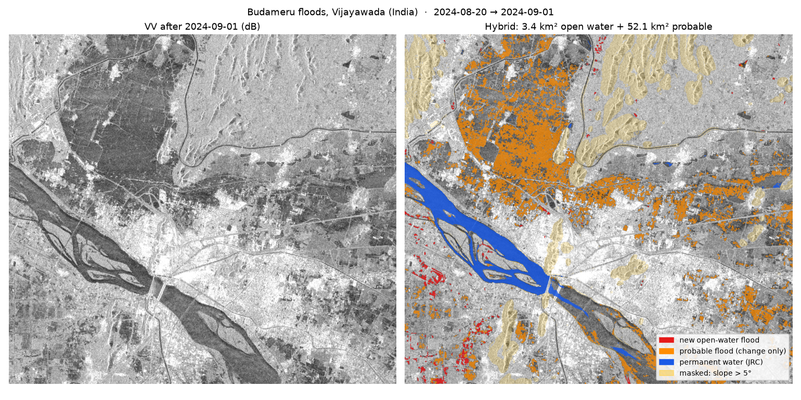
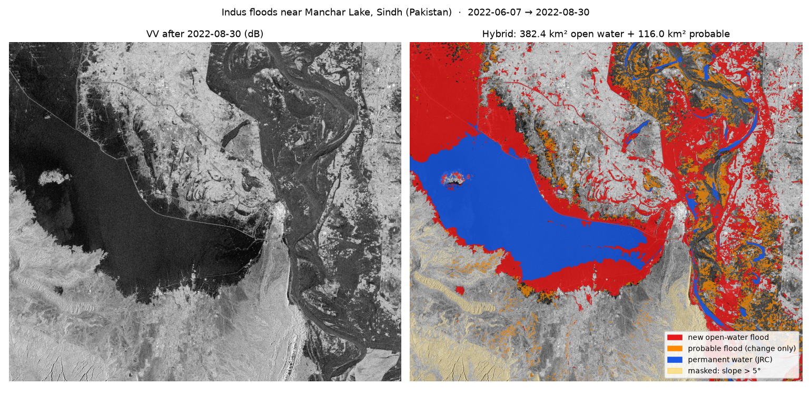
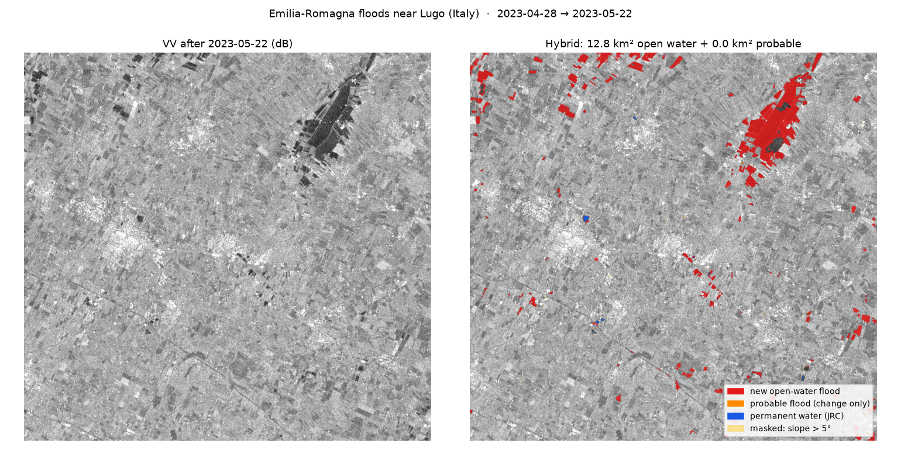
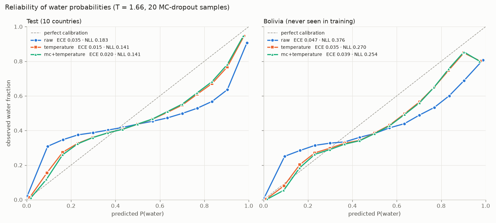

# TerraSignal

**Pick any place on Earth and two dates. TerraSignal maps what flooded, and how confident it is.**

TerraSignal compares free Sentinel-1 radar imagery from before and after an event. Radar sees through clouds, which matters because floods arrive under monsoon skies. It works for any bounding box on the planet, from the command line or an HTTP API, and returns map-ready rasters, flood polygons with areas, and calibrated confidence.



## Results at a glance

Water segmentation IoU on hand-labeled Sen1Floods11 chips, **rebuilt from the same Planetary Computer imagery TerraSignal runs on** (see [the domain gap](#the-domain-gap-the-most-important-finding)):

| | Otsu baseline | U-Net trained on GEE | **U-Net trained on PC (default)** |
|---|---|---|---|
| Test, 9 countries | 0.481 | 0.263 | **0.683** |
| India | 0.660 | 0.042 | **0.685** |
| **Bolivia (country never seen in training)** | 0.450 | 0.048 | **0.655** |

The default model beats the threshold baseline in all 9 test countries and in the held-out one. Its probabilities are temperature-calibrated (test ECE 0.035 → 0.016).

## How it works

```
any bbox + before/after dates
        │
        ▼
STAC search (Planetary Computer) ──► same-orbit Sentinel-1 pair
        │                              (same direction + relative orbit, ≥90% coverage)
        ▼
aligned stack on a local UTM grid, 10 m
  VV/VH before · VV/VH after · Copernicus DEM · JRC permanent water
        │
        ▼
U-Net water probability for each date (temperature-calibrated)
        │
        ▼
open-water flood  = water after, not before, outside permanent water and slopes > 5°
probable flood    = strong VV+VH backscatter drop without open water (lower confidence)
        │
        ▼
COGs · GeoJSON polygons (area, confidence) · summary with run-specific caveats
```

- **Same-orbit pairs:** radar backscatter depends on viewing geometry, so comparing an ascending pass with a descending one makes every hillside look as if it changed.
- **Masks:** permanent water (JRC occurrence ≥ 50%) isn't flood. Slopes over 5° (radar shadow) are masked, using the Copernicus DEM smoothed to 30 m. The DEM is a *surface* model, so unsmoothed building edges look like cliffs and whole cities get masked.

## Quick start

```bash
python -m uv venv .venv --python 3.12
python -m uv pip install --python .venv/Scripts/python.exe -e ".[dev,ml]"

# anywhere on Earth (area cap 2,500 km²)
terrasignal analyze --bbox 11.85 44.33 12.10 44.50 --before 2023-05-01 --after 2023-05-21 --name emilia
terrasignal analyze --case vijayawada_2024        # curated case; reuses a cached stack

# HTTP API: a job queue, because a run takes 1–7 minutes
uvicorn terrasignal.api:app --port 8000
curl -X POST localhost:8000/analyze -H "Content-Type: application/json" \
     -d '{"bbox":[11.85,44.33,12.10,44.50],"before":"2023-05-01","after":"2023-05-21"}'
curl localhost:8000/jobs/<job_id>                  # queued → running → done | failed
curl -O localhost:8000/jobs/<job_id>/files/flood.geojson
```

**Trained model:** the weights are on Hugging Face at [avk3/terrasignal-water-unet](https://huggingface.co/avk3/terrasignal-water-unet), so there's no need to train anything. Add `--ckpt hf://avk3/terrasignal-water-unet` to `analyze` or `detect`, and it downloads once and is cached. Without any checkpoint, `analyze` falls back to the classical baseline and says so in the summary.

| Output | Contents |
|---|---|
| `flood.tif` | COG, uint8: 0 none · 1 open-water flood · 2 permanent water · 3 masked steep · 4 probable flood · 255 no data |
| `confidence.tif` | COG, calibrated % probability of *new* open water: P(water after) × P(no water before) |
| `vv_before.tif`, `vv_after.tif` | COG backdrops for a before/after swipe (8-bit, −25 to 0 dB) |
| `flood.geojson` | WGS84 polygons, one per flood region, with class, exact area (km², counted on the projected grid) and mean confidence |
| `summary.json` | Scenes, dates, orbit, areas, model, timings, and caveats written for that run |

The API runs one worker, because one GPU and 8 GB of RAM fit one scene at a time. Bad boxes return 400. "No imagery" comes back as a failed job with the explanation, and the worker survives any exception. Downloads are served from a fixed whitelist.

## Case studies

| Case | Event | Open-water flood | Mean confidence | Probable |
|---|---|---|---|---|
| `vijayawada_2024` | Budameru urban floods, Andhra Pradesh (India) | 126 km² | 71% | 1 km² |
| `assam_2024` | Brahmaputra monsoon floods, Assam (India) | 245 km² | 69% | 0 km² |
| `wayanad_2024` | Landslide, Kerala (India; **control**: should find ~nothing) | 0.1 km² | 58% | 0 km² |
| `pakistan_2022` | Indus floods near Manchar Lake (Pakistan) | 755 km² | 81% | 6 km² |
| `emilia_2023` | Emilia-Romagna, Italy (**not in training**) | 12.8 km² | 78% | 0 km² |
| `derna_2023` | Libya dam-break flash flood (hard case) | 1.7 km² | 56% | 0 km² |

**Vijayawada** (map at the top): the flooded north-west neighbourhoods are mapped as open water. The scattered field-shaped patches to the south-west and east are most likely **rice paddies flooded for transplanting**, which radar can't tell from flood water. The 126 km² overstates the flood, and the run's summary warns about this.

**Pakistan:** open water fills the inundated Indus floodplain and the overflowing fringe of Manchar Lake.


**Emilia-Romagna** (a region and country the model never trained on): the inundated block north-east of Lugo is mapped completely. The old GEE-trained model gave it P(water) ≈ 0.01.


**Data gaps are real:** Cyclone Michaung flooded Chennai in December 2023, but Sentinel-1 recorded **no passes** over it from 2023-11-25 to 2024-01-15. TerraSignal reports a missing pair instead of quietly comparing two pre-event images (a bug the first version had; see `test_after_never_drawn_from_before_window`).

## The domain gap: the most important finding

The first U-Net was trained on Sen1Floods11's original imagery, Google Earth Engine (GEE) σ⁰, and scored 0.669 IoU against Otsu's 0.470. Then three clues disagreed:
- It missed a water-dark flooded block in Emilia-Romagna (P ≈ 0.01).
- Its Bolivia IoU swung from 0.72 to 0.28 across a ±4 dB brightness shift.
- A check on live data found it detected **0% of the permanent Krishna and Brahmaputra rivers**.

The inference pipeline was ruled out: run on the Sen1Floods11 chips, it reproduces the evaluation IoU exactly.

**The cause was texture, not brightness:**

| | Water VV | Water VH | Texture over water (7×7 std) | Texture over land |
|---|---|---|---|---|
| Sen1Floods11, India (GEE σ⁰) | −19.6 dB | −25.5 dB | **2.53 dB, noisier than land** | 1.98 dB |
| Planetary Computer RTC, Vijayawada | −18.6 dB | −22.2 dB | **1.63 dB, smoother than land** | 1.99 dB |

Unprocessed GEE imagery sits near the radar noise floor over water and looks noisy. Planetary Computer's terrain-corrected (RTC) product makes the same water smooth. The CNN had learned "water = dark *and noisy*". Wider brightness augmentation (±4 dB) didn't help, and neither did Lee-filtering both sources: the texture inversion survives filtering.

**The fix: train and evaluate in the deployment domain.** Sen1Floods11's metadata gives each event's acquisition date, orbit direction and relative orbit. `train/build_pc_chips.py` rebuilds each hand-labeled chip from the *same acquisition* on Planetary Computer, on the chip's exact pixel grid:
- 379 of 446 chips rebuilt (Paraguay isn't in Planetary Computer's archive)
- measured RTC − GEE offset: **+1.41 dB** median, matching γ⁰ vs σ⁰ theory
- alignment: 9×9-smoothed VV correlation **0.954** median. Each chip is co-registered by its best integer shift (usually 0–2 px), and chips under 0.6 are dropped
- split: 204 train, 73 valid, 75 test, 15 Bolivia

| Check on live data | GEE-trained | PC-trained |
|---|---|---|
| Permanent-water recall (JRC ≥ 90%), five case stacks | 0.00 – 0.37 | **0.99 – 1.00** |
| Emilia flooded block detected | 2% | **100%** |
| Dry-land false-positive rate (JRC = 0, flat), before images | 0.0001 – 0.018 | 0.008 – **0.306** |

Training on PC chips plus the GEE chips ("both") scored slightly lower (test 0.670, Bolivia 0.585): mismatched texture costs more than the extra data adds.

## Calibration

`train/calibrate.py` fits one temperature on the PC *validation* split and scores calibration on test and Bolivia, which aren't used for fitting:

| | ECE test | ECE Bolivia | Error-detection AUROC (test / Bolivia) |
|---|---|---|---|
| Raw | 0.035 | 0.047 | |
| **Temperature, T = 1.66 (default)** | **0.016** | **0.035** | 0.90 / 0.74 (distance from 50%) |
| 20× MC dropout + T | 0.020 | 0.039 | 0.79 / 0.68 (sample spread) |



- **Raw probabilities were overconfident.** Temperature scaling fixes most of it, though less in the unseen country.
- **MC dropout didn't earn its cost.** In both the GEE and PC experiments it calibrates no better than temperature scaling, and flags errors worse than the calibrated margin. It stays available (`mc_samples`), and it's cheap: only the 1×1 head is resampled.
- **Mid-range predictions (0.6–0.9) are still overconfident**, which is where flood edges sit. A single temperature can't fix that S-shape; isotonic calibration is the next thing to try.

## Known limitations

- **Rice paddies and waterlogged fields** are new water as far as radar is concerned. Expect field-shaped false floods in irrigated farmland during planting season.
- **The model fills braided river corridors.** In Assam's dry season it labels sandbars between channels (VV ≈ −9 dB, land-level) as water, probably learned from monsoon-season labels. That's 31% false positives on never-water flat land in Assam's March image. A backscatter plausibility gate would cut this, but it lowered validation IoU (0.716 → 0.684), so it's not applied. In flood mapping this mostly fails safe: extra water in the *before* image suppresses floods rather than inventing them.
- **"Probable flood" is a heuristic.** It requires VV drop ≥ 2 dB, VH drop ≥ 3 dB and VH after ≤ −18 dB, and it isn't fitted to labels, since no public dataset labels flooded urban areas in SAR.
- **Flash floods that drain before the satellite pass are invisible** (Derna). Mapping that damage needs a different signal, radar coherence loss.
- **Absence of evidence in steep terrain:** Wayanad is 97% masked as steep. "No flood found" there isn't evidence of no flood, and the summary says so.
- **Sentinel-1 coverage has gaps** (Chennai, December 2023), and 2022–2024 revisit over India was 12 days.

## The classical baseline

`terrasignal baseline` is the reference the model has to beat, and the fallback when no checkpoint exists:
1. Lee speckle filter.
2. Split-based Otsu, pooling 256 px tiles with clearly bimodal histograms (Ashman's D > 2), clamped to −23…−14 dB, with a −18 dB fallback for water-free scenes.
3. Flood = new water with a VV drop ≥ 3 dB, using the same masks.

It transfers across data sources because it adapts to each scene. Its weaknesses are dry sand that looks like water, water among buildings that's too bright, and fast rough water that gets brighter.

| Case | Baseline flood | Steep masked |
|---|---|---|
| Pakistan 2022 | 471 km² | 6% |
| Assam 2024 | 60 km² | 1% |
| Vijayawada 2024 | 42 km² | 11% |

## Reproducing the model

```bash
python train/download_sen1floods11.py                 # 732 MB, hand-labeled chips
python train/build_pc_chips.py                        # rebuild them from Planetary Computer
python train/train_water.py --source pc --epochs 80 --out checkpoints/water_unet.pt   # ~38 min, GTX 1650
python train/calibrate.py --source pc --tag _pc       # stores T in the checkpoint
python train/evaluate_water.py --source pc            # per-country IoU vs Otsu
python train/robustness.py --source pc                # IoU vs calibration shift
python train/domain_check.py                          # permanent-water recall on live stacks
```

The U-Net uses a ResNet34 encoder (ImageNet weights), takes VV and VH in dB, and is trained with random crops, flips, rotations, ±2 dB brightness offsets, and dropout before the head.

> **GTX 16-series:** fp16 returns NaN on these cards (no tensor cores), so `amp_ok()` runs everything in fp32. That's also about 4× faster than the broken fp16 path.

Result files: `docs/results_water_pc_on_pc.json`, `docs/results_water_v1_on_pc.json` (GEE model on PC), `docs/results_water.json` (GEE model on GEE), `docs/calibration_pc.json`, `docs/robustness_*.json`, `docs/domain_check_*.json`.

## Hardware

Built on a GTX 1650 (4 GB VRAM) with 8 GB of RAM. The 2,500 km² area cap keeps one request to a few hundred MB in memory.
