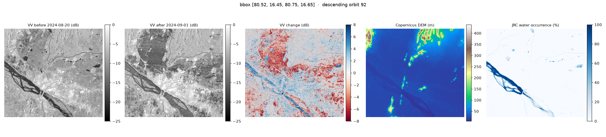
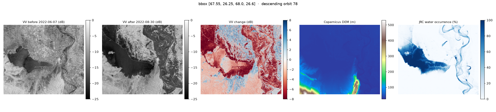
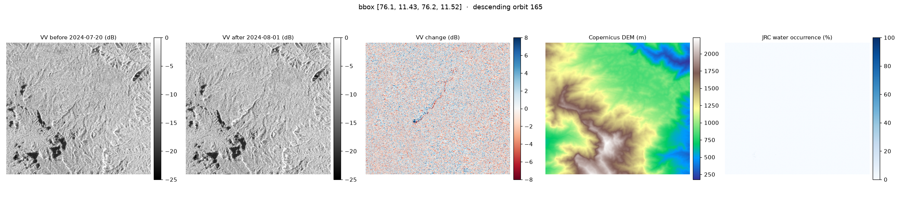
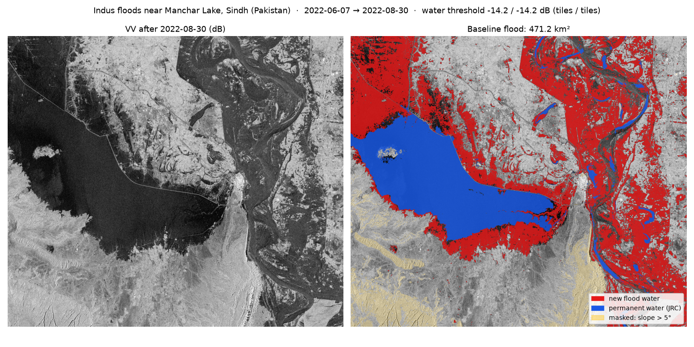
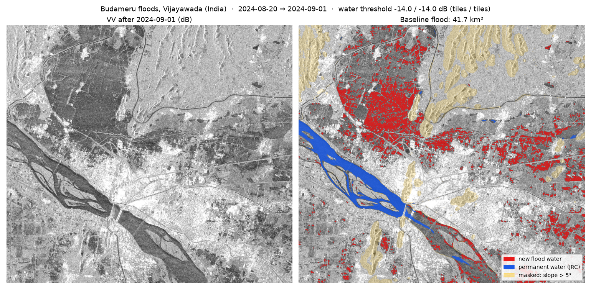
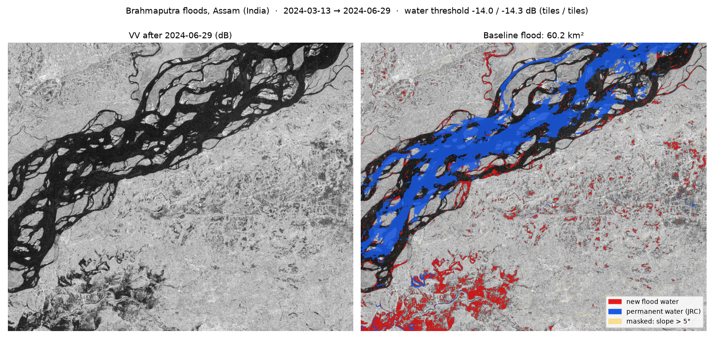
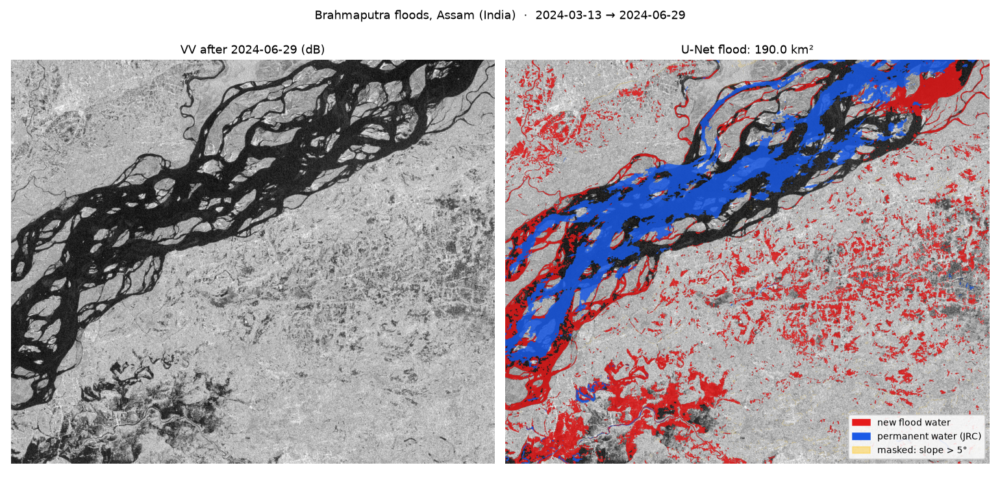
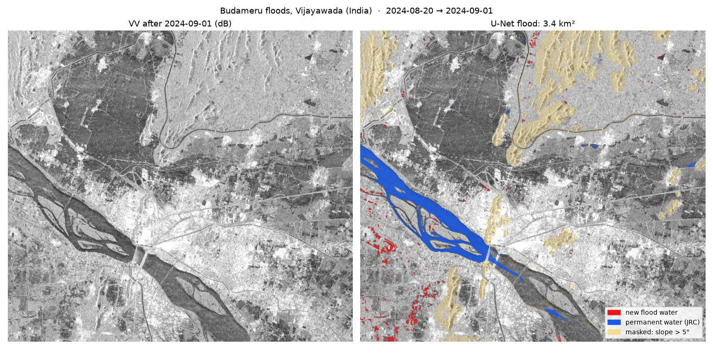

# TerraSignal

**Pick any place on Earth and two dates. TerraSignal shows what changed and how confident it is.**

TerraSignal compares free Sentinel-1 radar imagery over time to map floods and other surface change. Radar sees through clouds, which matters because floods arrive under monsoon skies. The pipeline works for any bounding box on the planet. Curated case studies cover India and the rest of the world.

> Status: Phase 1 in progress (flood mapping). Fetch, classical baseline, U-Net water model, hybrid detector and calibrated confidence are done; packaging as one CLI/API command is next.

## How it works

```
any bbox + before/after dates
        │
        ▼
STAC search (Planetary Computer) ──► pick a same-orbit Sentinel-1 pair
        │                              (same direction + relative orbit, ≥90% coverage)
        ▼
aligned stack on a local UTM grid, 10 m
  VV/VH before · VV/VH after · Copernicus DEM · JRC permanent water
        │
        ▼
water(after) − water(before) − permanent water − steep/shadowed terrain
        │
        ▼
flood map + confidence + area (km²)
```

Why same-orbit pairs: radar backscatter depends on viewing geometry. Comparing an ascending pass with a descending one makes every hillside look as if it changed.

## Data (all free)

| Layer | Source | Purpose |
|---|---|---|
| Sentinel-1 RTC (VV, VH) | Microsoft Planetary Computer | Radar backscatter that sees through clouds |
| Copernicus DEM GLO-30 | Planetary Computer | Terrain masks (radar shadow, steep slopes) |
| JRC Global Surface Water | Planetary Computer | Permanent rivers and lakes, which are not floods |
| Sen1Floods11 | Google Cloud public bucket | Training and hand-labeled test data |

## Case studies

| Case | Region | Event |
|---|---|---|
| `assam_2024` | India | Brahmaputra monsoon floods |
| `vijayawada_2024` | India | Budameru urban floods |
| `wayanad_2024` | India | Mundakkai landslide (a non-flood control case) |
| `pakistan_2022` | Pakistan | Indus floods near Manchar Lake |
| `derna_2023` | Libya | Storm Daniel dam-break flash flood (a hard case) |

## First results (raw radar, before any model)

Each panel row shows VV before, VV after, the change in dB, elevation, and permanent water. In the change panel, red means the backscatter dropped, which is typical of new open water.

**Vijayawada, India, 2024:** the Budameru overflow floods the north-west of the city.


**Sindh, Pakistan, 2022:** Manchar Lake spreads far past its permanent extent.


**Wayanad, India, 2024 (landslide control case):** the debris track is the diagonal streak. The dark patches in both radar images are shadow on steep slopes, not water, which is why the elevation mask exists.


### Data gaps are real
Cyclone Michaung flooded Chennai in December 2023, but Sentinel-1 recorded **no passes** over the city from 2023-11-25 to 2024-01-15. TerraSignal reports this instead of quietly pairing two pre-event images (a bug the first version had; see `test_after_never_drawn_from_before_window`).

## Classical baseline

The baseline is the bar the learned model has to beat:

1. **Lee speckle filter** (7×7) on linear VV backscatter, ignoring missing pixels.
2. **Split-based Otsu threshold.** A single global Otsu fails when water is a small part of the scene. Instead, the threshold is pooled from 256 px tiles whose histograms are clearly bimodal (Ashman's D > 2, each class ≥ 10%, the dark class water-like). It is clamped to the physically plausible range of −23 to −14 dB, and a scene with no qualifying tile falls back to −18 dB.
3. **Flood** = water after, not water before, a VV drop of at least 3 dB, not permanent water (JRC occurrence ≥ 50%), and slope ≤ 5°.
4. **Cleanup:** clusters smaller than 0.5 ha are removed.

Slope comes from the Copernicus DEM smoothed to 30 m. The DEM is a *surface* model, so without smoothing, building edges look like cliffs and whole cities get masked as steep terrain.

```bash
terrasignal baseline --case all
terrasignal detect --case all     # U-Net (needs checkpoints/water_unet.pt)
```

| Case | Flood found | Valid area | Water threshold (before / after) | Masked as steep |
|---|---|---|---|---|
| Pakistan 2022 | **471 km²** | 1,775 km² | −14.2 / −14.2 dB | 6% |
| Assam 2024 | **60 km²** | 1,341 km² | −14.0 / −14.3 dB | 1% |
| Vijayawada 2024 | **42 km²** | 545 km² | −14.0 / −14.0 dB | 11% |
| Derna 2023 | 0.04 km² | 161 km² | −14.0 / −14.0 dB | 37% |
| Wayanad 2024 (control) | 0 km² | 110 km² | fallback −18 dB | 97% |





### Where the baseline fails (and what the model must fix)

- **Dry sand looks like water.** Brahmaputra sandbars were dark in March, so the baseline treats channels that filled by June as "already water" and undercounts the river's spread.
- **Water among buildings and vegetation is missed.** In Vijayawada's flooded neighbourhoods, backscatter sits around −12 dB because of double bounce, above the −14 dB threshold. The raw Otsu threshold there was −10.4 dB; only the clamp stopped it from flagging bare land.
- **Rice paddies look like floods.** Fields flooded for transplanting in August–September show up as scattered false positives east of Vijayawada.
- **Fast, rough floodwater gets brighter, not darker**, so the "dark = water" rule misses it (the Krishna river in Vijayawada).
- **Flash floods recede before the next pass.** Derna's flood had drained by 2023-09-12, so there is no open water to find. Mapping its damage needs a different signal (loss of radar coherence).
- **The Wayanad control passes mostly because 97% of it is masked as steep.** That's weak evidence that the baseline doesn't over-fire; Sen1Floods11 gives a real test in 1.3.

## Learned water model (U-Net)

A U-Net with a ResNet34 encoder (ImageNet weights) takes VV and VH in dB and outputs water probability. It is trained on the 252 hand-labeled Sen1Floods11 chips (10 countries) and validated on 89 more. Training uses:
- random 256 px crops, flips and rotations
- **random ±2 dB brightness offsets**, because the training data is GEE σ⁰ while inference uses Planetary Computer RTC γ⁰ (measured over water, the two differ by 1–3 dB)
- dropout before the output head, which MC-dropout confidence in 1.4 relies on

Training took 48 min for 80 epochs on a GTX 1650. The best checkpoint came at epoch 44 (validation IoU 0.691), and later epochs overfit ([log](docs/train_log_water_unet.csv)).

> **GTX 16-series note:** fp16 mixed precision returns NaN on these cards (no tensor cores), so `amp_ok()` turns it off there and everything runs in fp32. That's also 4× *faster* than the broken fp16 path.

### Results: water IoU on hand-labeled chips the model never saw

```bash
python train/train_water.py --epochs 80
python train/evaluate_water.py
```

| Region | Otsu baseline | U-Net | U-Net, inputs +1 dB |
|---|---|---|---|
| **Test, all 10 countries** | 0.470 | **0.669** | 0.670 |
| Sri Lanka | 0.205 | **0.849** | 0.840 |
| USA | 0.275 | **0.558** | 0.565 |
| Somalia | 0.203 | **0.425** | 0.408 |
| Paraguay | 0.399 | **0.631** | 0.650 |
| Nigeria | 0.774 | **0.884** | 0.888 |
| Mekong | 0.755 | **0.836** | 0.843 |
| Spain | 0.647 | **0.721** | 0.725 |
| Ghana | 0.459 | **0.529** | 0.528 |
| Pakistan | 0.147 | **0.243** | 0.256 |
| India | **0.691** | 0.672 | 0.670 |
| **Bolivia (country never seen in training)** | **0.645** | 0.642 | 0.598 |

Across the test set, precision rises from 0.72 to 0.82 and recall from 0.57 to 0.78. Full results are in [docs/results_water.json](docs/results_water.json).

**What this does and doesn't show:**
- The U-Net clearly beats thresholding on countries it trained on (9 of 10), and a +1 dB calibration shift doesn't hurt it there.
- **In a brand-new country (Bolivia) it only ties the baseline, and the +1 dB shift costs it 0.04 IoU.** "Works anywhere" is not yet earned; more diverse training data (for example the 4,385 weakly labeled Sen1Floods11 chips) is the obvious next lever.
- India is a narrow loss to Otsu.

### On real events: complementary, not better

**Assam:** the U-Net catches the Brahmaputra spreading over March sandbars, which the baseline missed (190 km² vs 60 km²).


**Vijayawada:** the U-Net **misses the flooded neighbourhoods** (3.4 km² vs the baseline's 42 km²). In that zone VV after the flood has a median of −13.5 dB, brighter than open water, because buildings and vegetation stick out of the water. VV dropped about 3 dB and VH about 4.6 dB, yet the model gives P(water) = 0.00. Sen1Floods11 labels come from optical imagery and mark open water, so the model learned "water = very dark".


## Hybrid detector (the default)

`terrasignal detect` combines the two signals and keeps them apart in the output:

| Class | Rule | Catches | Typical false positives |
|---|---|---|---|
| **Open-water flood** (red) | U-Net P(water) ≥ 0.5 after the event, not before | Rivers spreading, lakes overflowing, inundated fields | Few |
| **Probable flood** (orange) | VV drops ≥ 2 dB **and** VH drops ≥ 3 dB **and** VH after ≤ −18 dB, outside open water | Water among buildings and vegetation, partly submerged fields | Paddy fields flooded for planting, wet soil |

Both classes exclude permanent water and slopes over 5°, and drop clusters under 0.5 ha. The change thresholds are physics-motivated heuristics, **not fitted to labels**. No public dataset labels flooded-urban pixels in SAR, so they're checked visually on the case studies and should be treated as such.

| Case | Baseline | U-Net only | Hybrid: open water + probable |
|---|---|---|---|
| Pakistan 2022 | 471 km² | 382 km² | 382 + 116 km² |
| Assam 2024 | 60 km² | 190 km² | 190 + 19 km² |
| Vijayawada 2024 | 42 km² | 3.4 km² | 3.4 + **52** km² |
| Derna 2023 | 0.04 km² | 0.03 km² | 0.03 + 0.08 km² |
| Wayanad 2024 (control) | 0 km² | 0 km² | 0 + 0 km² |

**Vijayawada:** the flooded neighbourhoods that the U-Net missed are now mapped as probable flood.


**Pakistan:** open water around the lake and the Indus, with probable flood on the partly submerged floodplain between them.


## Calibrated confidence

A probability is only useful if it means what it says. `train/calibrate.py` fits a single **temperature** on the validation split, then measures calibration on test and Bolivia, which are never used for fitting.

| | ECE test | ECE Bolivia | NLL test | NLL Bolivia | Error-detection AUROC (test / Bolivia) |
|---|---|---|---|---|---|
| Raw U-Net | 0.032 | 0.041 | 0.167 | 0.211 | |
| **Temperature, T = 1.55 (default)** | **0.015** | **0.016** | 0.135 | 0.176 | **0.90 / 0.89** (distance from 50%) |
| 20× MC dropout + T | 0.018 | 0.017 | 0.134 | 0.177 | 0.85 / 0.75 (sample spread) |


- **The raw model was overconfident** (T > 1). Temperature scaling halves the calibration error, including in Bolivia, the country it never saw.
- **MC dropout didn't earn its cost.** It calibrates no better, and its sample spread flags errors *worse* than the calibrated probability's distance from 50%. A single dropout layer before the head captures little model uncertainty. The default is therefore one calibrated pass; `mc_samples` stays available. Sampling is cheap anyway, because only the 1×1 head is resampled (`logit_samples`).
- **Known limitation:** after scaling, mid-range predictions on the test split (0.6–0.9) are still overconfident (0.77 predicted → 0.53 observed). The overall ECE is small because most pixels sit near 0 or 1, but flood *edges* live in that range. A single temperature can't fix that S-shape; isotonic or Platt calibration is the next thing to try.

`terrasignal detect` now also writes `model_confidence.tif`, the per-pixel probability of *new* water, P(water after) × P(no water before), in %. The mean over each case's open-water flood tracks how clear the event is: Pakistan 84%, Assam 74%, Vijayawada 62%, Derna 54%. The orange "probable flood" class has no learned probability and is reported separately.

## Quick start

```bash
python -m uv venv .venv --python 3.12
python -m uv pip install --python .venv/Scripts/python.exe -e ".[dev]"

# a curated case
.venv/Scripts/python.exe -m terrasignal.cli fetch --case wayanad_2024

# anywhere on Earth (area cap: 2,500 km²)
.venv/Scripts/python.exe -m terrasignal.cli fetch --bbox 92.1 26.25 92.5 26.55 --before 2024-03-01 --after 2024-07-04
```

Each run writes `data/<name>/` with one GeoTIFF per layer, `meta.json` (the scenes used, dates, orbit) and `quicklook.png`.

## Roadmap

- **Phase 1: flood mapping**
  - [x] 1.1 Fetch any AOI with same-orbit pairing, aligned DEM and permanent water
  - [x] 1.2 Otsu baseline with terrain and permanent-water masks
  - [x] 1.3 U-Net trained on Sen1Floods11, compared to the baseline per country
  - [x] 1.4 Calibrated confidence (temperature scaling; MC dropout tested and kept optional)
  - [ ] 1.5 CLI and API that output COG, GeoJSON and stats
- **Phase 2:** interactive map with a before/after swipe
- **Phase 3:** urban change detection (Sentinel-2, OSCD, Siamese network)
- **Phase 4:** evaluation page and write-up
- **Phase 5:** foundation-model fine-tune (Prithvi) and an Earth Engine global overview

## Hardware

Developed on a GTX 1650 (4 GB VRAM) with 8 GB of RAM. The area cap keeps one request to a few hundred MB in memory.
